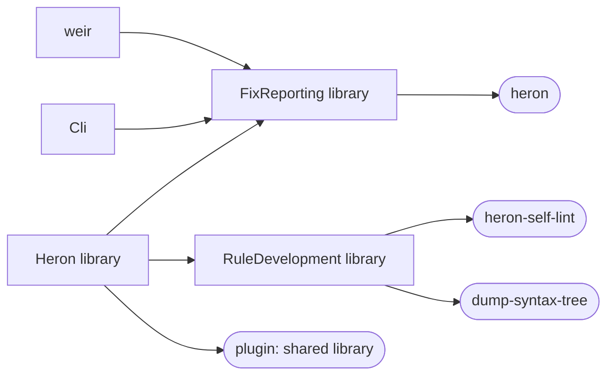
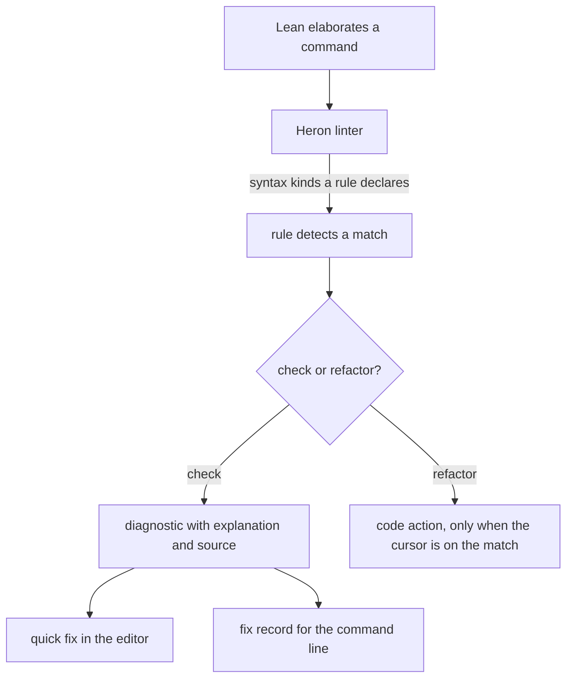
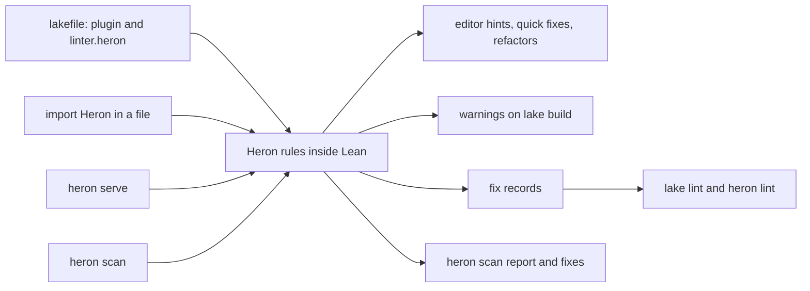
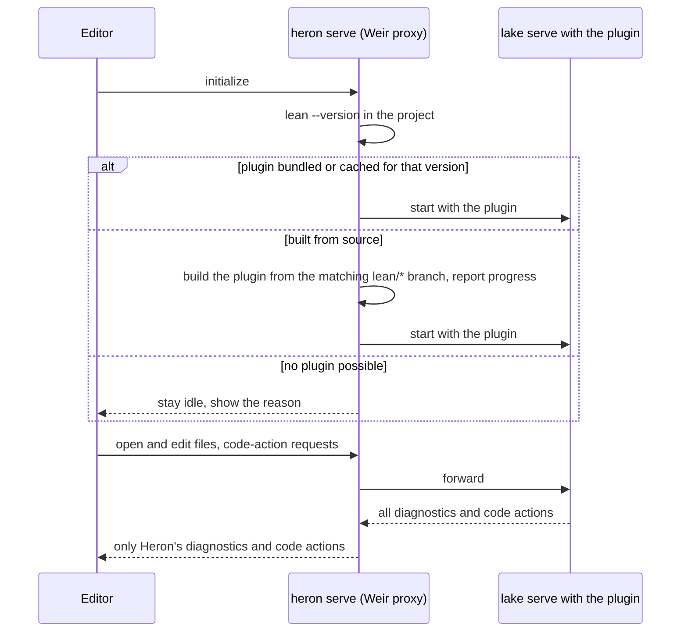
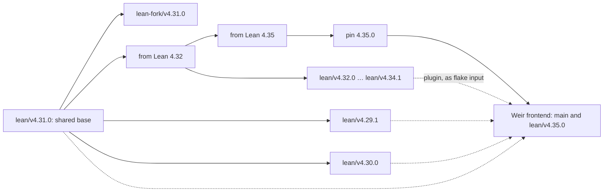
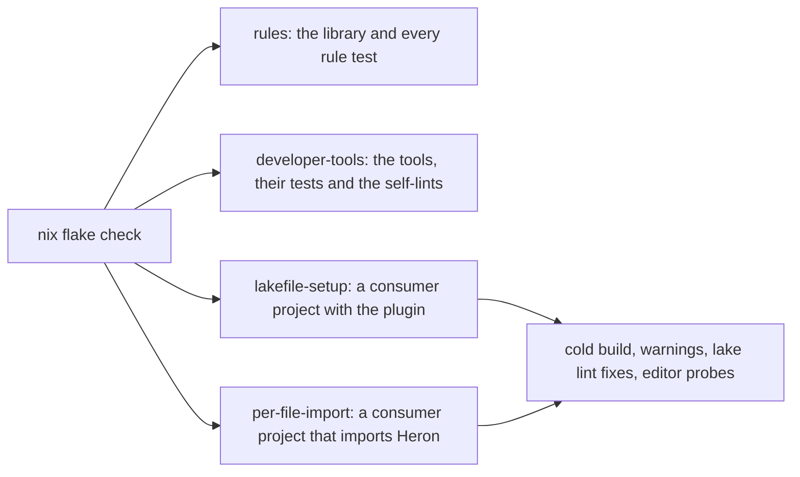

# Architecture

Heron runs inside the Lean compiler. Its rules are Lean code, compiled into a library that Lean
loads as a plugin or an import, and the `heron` command line tool reports and applies what those
rules find. [Style](style.md) explains how to write a rule.

## Lake targets

`Heron` holds the rule framework and every rule, and is the only part a Lean project loads.
`FixReporting` builds the `heron` executable on [lean4-cli](https://github.com/leanprover/lean4-cli)
and [Weir](https://codeberg.org/wvhulle/weir). `RuleDevelopment` holds tools for rule authors:
a showcase, profiling, the syntax-tree dump and the self-lints that check how rules are written.

## Rules

A **check** runs on every command once `linter.heron` is on. A **refactor** never flags anything
and only answers code-action requests. Both match the syntax Lean has already parsed and
elaborated, ask the info tree for types and names, and build their fix as one quotation over the
matched node, so the user's comments and layout between the reused pieces stay as written. Rules
that replace an expression by an equal one name a lemma from Lean core instead, and its proof is
what makes the fix correct.

## How Heron reaches a project

The [lakefile setup](setup.md#lakefile-setup) loads the `plugin` target into every Lean process
of the project, and `lake lint` runs `heron lint`, which builds the project and reads the fix
records the build wrote. The [per-file import](setup.md#per-file-import) loads the same rules
through `import Heron`. Without project changes, `heron scan` elaborates the files itself and
`heron serve` runs the plugin in a language server of its own. In every case the plugin must be
built with the project's exact Lean version.

## `heron serve`

Weir is a reusable proxy in front of `lake serve`; Heron only tells it its plugin target, how to
recognise its own diagnostics and code actions, and which repository holds the release branches.
[Editor setup](editor.md#progress-and-idle-states) describes the idle cases.

## Release branches

Each supported Lean release has its own branch, because the plugin must match the compiler
exactly. The branches share as much as possible:

- Changes that work on every toolchain live in the shared base.
- A workaround for a Lean API change is one step at the first minor version that needs it, and
  every newer branch builds on it.
- A branch adds only its toolchain pin.

`main` is the newest release plus the `heron serve` frontend. Its Nix package bundles the plugins
of all older stock branches, which it takes as flake inputs. The fork branch builds against
[a Lean fork](https://github.com/wvhulle/lean4) with richer hover popups.

## CI

The rule tests are compile-time assertions, so building the library runs them. The consumer
checks build a small project from scratch, compare its `lake lint --json` output with the expected
fixes and probe its language server. Woodpecker on Codeberg runs the same `nix flake check` on
every branch and fills the Cachix cache; the GitHub repository is a mirror.
